# Лабораторна робота 2: згорткові нейронні мережі для класифікації аерознімків (AID, варіант 3)

Класифікація 30 типів сцен на аерознімках [AID](https://www.kaggle.com/datasets/jiayuanchengala/aid-scene-classification-datasets):
transfer learning на ResNet18, аугментація, fine-tuning, компактна CNN-учень і дистиляція знань, аналіз помилок
(матриці помилок, Grad-CAM) і стійкість до спотворень.

Усі навчання виконувались на Kaggle (GPU Tesla T4). Ноутбуки в репозиторії збережені **разом із результатами виконання**.

## Коротко: результати

| # | Запуск | Що змінилось порівняно з попереднім | Параметрів | val acc | **test acc** | **test macro-F1** |
|---|---|---|---:|---:|---:|---:|
| 3 | `exp3_frozen` | ResNet18 (ImageNet), заморожена основа, навчається лише `fc` | 11.2 M (навч. 15 K) | 0.800 | 0.805 | 0.806 |
| 4 | `exp4_frozen_aug` | **+ аугментація** train | 11.2 M (навч. 15 K) | 0.800 | 0.790 | 0.789 |
| 5 | `exp5_finetune` | **+ розморожено `layer4`**, LR у 10 разів менший | 11.2 M (навч. 8.4 M) | 0.902 | **0.903** | 0.901 |
| 6 | `exp6_student` | **нова модель:** компактна SmallCNN з нуля, 40 епох | 1.18 M | 0.867 | 0.882 | 0.881 |
| 7 | `exp7_student_kd` | **+ дистиляція** від exp5 (T = 4, α = 0.7) | 1.18 M | 0.887 | 0.885 | 0.881 |
| + | `student_200ep` | exp6, але **200 епох** замість 40 | 1.18 M | 0.902 | **0.903** | **0.903** |
| + | `student_kd_200ep` | exp7, але **200 епох** замість 40 | 1.18 M | **0.924** | 0.902 | 0.900 |

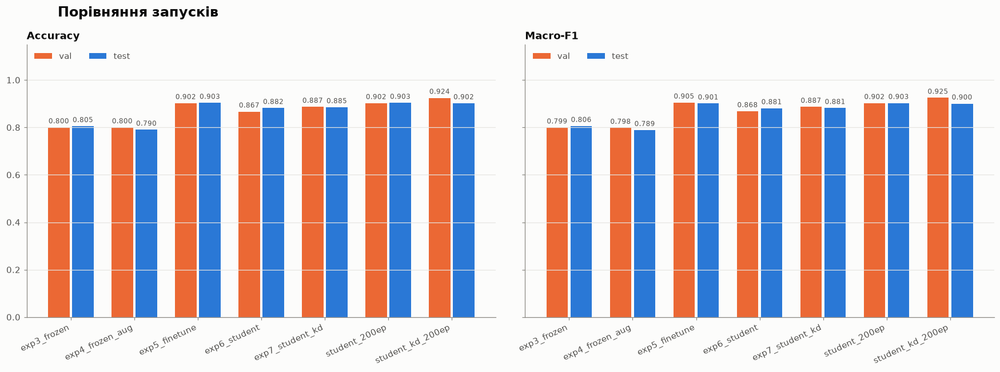

* **Найточніша** — `exp5_finetune` (test acc 0.903). Учень після 200 епох (`student_200ep`) має таку саму test accuracy
  при **9.5 раза меншій** кількості параметрів.
* **Найкомпактніша і найшвидша** — SmallCNN: 1.18 млн параметрів, 4.5 МБ, 11 мс на зображення на CPU проти 31 мс у ResNet18.
* **Найстійкіша до спотворень** — `exp5_finetune`: середня accuracy на спотворених зображеннях 0.787.

Тест — 600 зображень, тому одне зображення змінює test accuracy на 0.17 п.п. Валідація — 450 зображень,
одне зображення = 0.22 п.п. Різниці менші за ~1 п.п. варто вважати шумом.

---

## Зміст

1. [Як читати цей звіт](#як-читати-цей-звіт)
2. [Дані](#1-дані)
3. [Поділ на train / val / test](#2-поділ-на-train--val--test)
4. [Спільні налаштування всіх запусків](#3-спільні-налаштування-всіх-запусків)
5. [exp3: заморожена ResNet18](#exp3-заморожена-resnet18-завдання-3)
6. [exp4: + аугментація](#exp4--аугментація-завдання-4)
7. [exp5: + fine-tuning layer4](#exp5--fine-tuning-layer4-завдання-5)
8. [exp6: компактний учень](#exp6-компактний-учень-smallcnn-завдання-6)
9. [exp7: + дистиляція знань](#exp7--дистиляція-знань-завдання-7)
10. [Учні на 200 епох](#учні-на-200-епох-додатковий-експеримент)
11. [Аналіз помилок і Grad-CAM](#аналіз-помилок-і-grad-cam-завдання-8)
12. [Покращення та погіршення по класах](#покращення-та-погіршення-по-класах-завдання-9)
13. [Стійкість, розмір і швидкість](#стійкість-розмір-і-швидкість-завдання-10)
14. [Висновки](#висновки)
15. [Структура репозиторію та відтворення](#структура-репозиторію)

---

## Як читати цей звіт

Експерименти утворюють два ланцюжки. На кожному кроці змінюється **рівно одна річ**, тому різницю між сусідніми
запусками можна пояснити саме цією зміною:

```
Ланцюжок учителя (ResNet18, ImageNet):
  exp3_frozen ──(+аугментація)──▶ exp4_frozen_aug ──(+розморожено layer4, LR÷10)──▶ exp5_finetune ══▶ учитель

Ланцюжок учня (SmallCNN з нуля):
  exp6_student ──────(+дистиляція від exp5)──────▶ exp7_student_kd
       │                                                 │
   (40 → 200 епох)                                  (40 → 200 епох)
       ▼                                                 ▼
  student_200ep ─────(+дистиляція від exp5)──────▶ student_kd_200ep
```

Для кожного запуску є однаковий набір розділів:
**що змінилось → налаштування → результат (з різницею до попереднього) → графік → висновок**.

Для кожного запуску також є дашборд у `plots/<запуск>.png`, побудований однаково для всіх запусків. На ньому:

* криві loss / accuracy / val macro-F1 із позначкою найкращої за validation епохи;
* підсумкові accuracy і macro-F1 на train / val / test;
* стійкість до спотворень (для exp3–exp7);
* F1 на тесті для кожного класу;
* матриця помилок на тесті.

---

## 1. Дані

**AID (Aerial Image Dataset):** 10 000 аерознімків Google Earth розміром 600×600 RGB, 30 класів сцен.
Ноутбук: [`Lab2_AID_stage2_data_analysis.ipynb`](Lab2_AID_stage2_data_analysis.ipynb).

* **Розподіл класів:** від 220 (`BaseballField`) до 420 (`Pond`, `Viaduct`) зображень, max/min = 1.9.
  Дисбаланс помірний, тому разом з accuracy рахуємо **macro-F1**, у якій усі класи мають однакову вагу.
* **Дублікатів немає:** перевірено MD5 файлів.
* **Кольори:** зображення темніші й менш контрастні, ніж ImageNet (mean RGB ≈ 0.40/0.41/0.37 проти 0.49/0.46/0.41).
  Попри це використовуємо нормалізацію ImageNet, бо на ній навчено ваги ResNet18.
* **Схожі класи:** є групи візуально схожих класів, і саме між ними пізніше виникає більшість помилок.
  Це житлова забудова трьох щільностей, `Center` / `Square` / `Church` / `Commercial` і `School` / `Resort` / `Park`.

| Розподіл зображень за класами | Приклади (по одному на клас) |
|---|---|
| 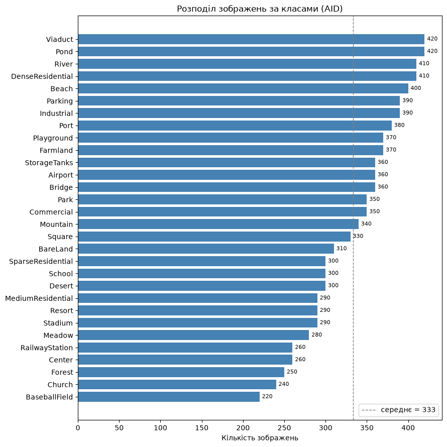 | 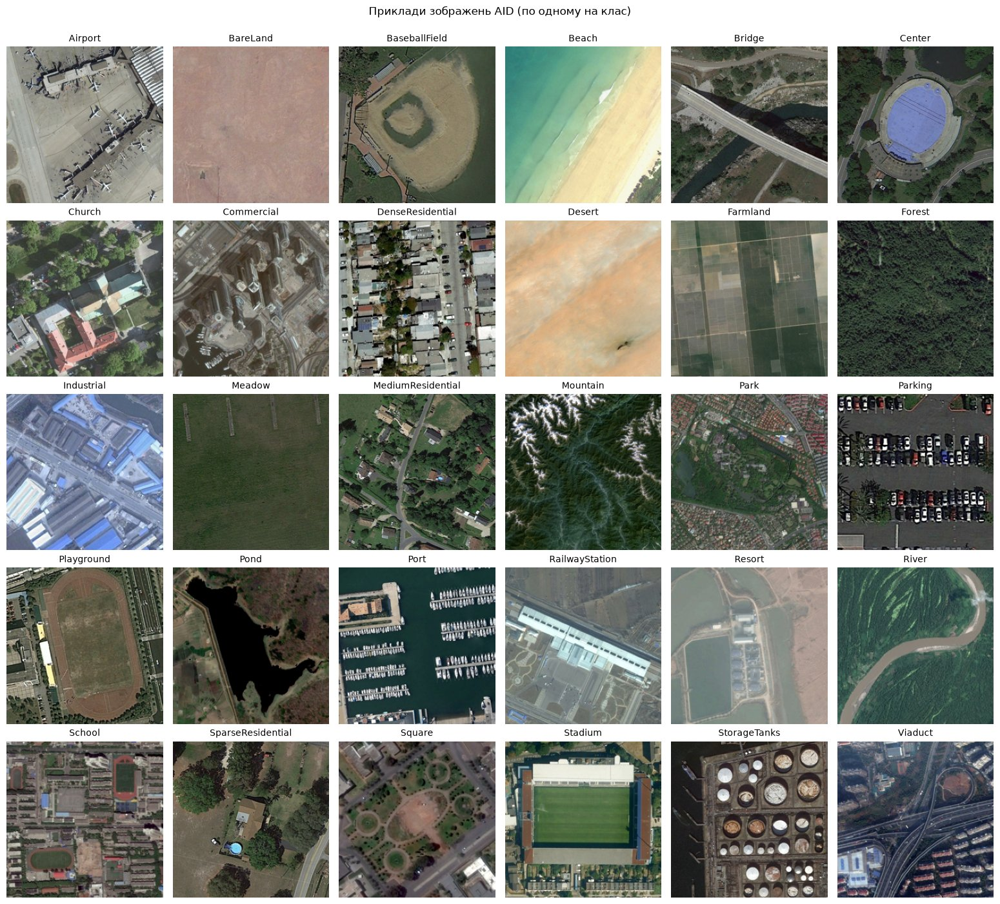 |

## 2. Поділ на train / val / test

Скрипт: [`make_split.py`](make_split.py). З кожного класу відбираємо **15 зображень у val і 20 у test**,
решта йде в train. Разом це **8950 / 450 / 600** зображень.

Чому поділ не випадковий. AID містить сусідні й перекриті знімки однієї місцевості. При випадковому поділі майже
однакові зображення потрапили б і в train, і в test, і оцінка вийшла б завищеною. Тому val і test відбираються так,
щоб усередині них не було надто схожих зображень. Алгоритм для кожного класу:

1. Для кожного зображення рахуємо ознаки ResNet18 (ImageNet); схожість між зображеннями — косинусна близькість ознак.
2. Перемішуємо зображення класу (`SEED = 42`) і по черзі беремо ті, чия схожість з усіма вже взятими нижча за поріг.
3. Поріг — 80-й перцентиль усіх попарних схожостей у класі. Якщо 35 зображень не набирається, поріг поступово
   послаблюється.

Зібраний поділ збережено в `artifacts/split.csv`. Ноутбуки на Kaggle містять той самий поділ у вигляді номерів файлів
(`VAL_TEST`) і перевіряють його через `assert`, тому **усі запуски використовують однаковий поділ**.

> Розділ 6 ноутбука `Lab2_AID_stage2_data_analysis.ipynb` описує ранній стратифікований поділ 70/15/15. Його клітинки
> не виконувались, і цей поділ не використовувався: його замінив `make_split.py`.

## 3. Спільні налаштування всіх запусків

* **Вхід:** 224×224. Усі зображення один раз зменшуються й кешуються в RAM як `uint8` (1.4 ГБ), нормалізація ImageNet
  виконується на GPU.
* **Аугментація** (лише train): для кожного зображення випадково обирається **одна** з трьох операцій.
  Кольорові аугментації свідомо не використовуємо: колір — важлива ознака класів (ліс, пустеля, пляж, ставок).

  | Операція | Параметри | Чому підходить для аерознімків |
  |---|---|---|
  | поворот | 90° / 180° / 270° | у знімка згори немає «верху» |
  | віддзеркалення | горизонтальне або вертикальне | дзеркальна сцена правдоподібна |
  | легке розмиття | ядро Гаусса 5×5, σ ∈ [0.5, 1.2] | імітує різну роздільність знімків |

* **Вибір моделі:** найкраща епоха — за **val accuracy**, остаточні метрики — на **test**. Test ніколи не використовується
  для вибору.
* **Чесні парні порівняння:** exp3/exp4 і exp6/exp7 стартують з **однакових початкових ваг** (`init_fc.pt`,
  `student_init.pt`). Також у них однакові епохи, оптимізатор, scheduler і порядок батчів.
* **Train-val gap** = accuracy на train **без аугментації** мінус val accuracy. Це головний показник перенавчання.
* Змішана точність (AMP fp16), batch size 64, `SEED = 42`.

---

## exp3: заморожена ResNet18 (завдання 3)

> **Що робимо:** беремо готові ознаки ImageNet і навчаємо поверх них лише лінійний класифікатор.

* **Модель:** ResNet18 з вагами ImageNet. Шар `fc` (512→1000) замінено на `Linear(512→30)`.
  Усі шари, крім `fc`, заморожені; BatchNorm у замороженій частині лишається в режимі `eval()`.
* **Навчається** лише 15 390 параметрів з 11 191 902, тобто це фактично логістична регресія на ознаках ImageNet.
* **Навчання:** Adam, LR 1e-3, weight decay 1e-4, cosine-розклад LR, 20 епох, **без аугментації**.
* Ноутбук: [`steps3_4/Lab2_AID_steps3_4.ipynb`](steps3_4/Lab2_AID_steps3_4.ipynb).

| | train | val | test |
|---|---:|---:|---:|
| accuracy | 0.957 | 0.800 | **0.805** |
| macro-F1 | 0.954 | 0.799 | **0.806** |

Найкраща епоха — 14 з 20. Навчання тривало 93 с. Train-val gap = **0.157**.

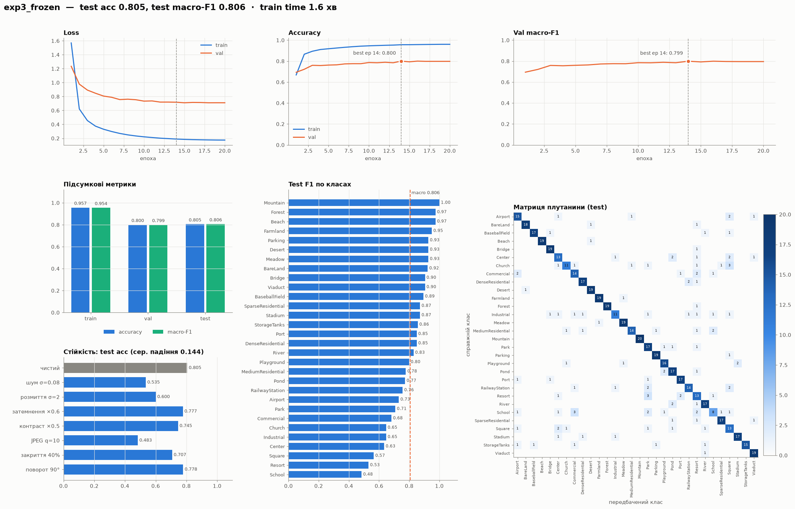

**Висновок.** Ознаки ImageNet без жодної адаптації вже дають 80% на 30 класах. Розрив train–val великий (15.7 п.п.):
лінійний класифікатор добре запам'ятовує train, але ознаки ImageNet погано розділяють схожі міські класи.
Найгірше розпізнаються `School` (F1 0.48), `Resort` (0.53), `Square` (0.57) і `Center` (0.63).

---

## exp4: + аугментація (завдання 4)

> **Що змінилось порівняно з exp3:** лише навчальний DataLoader, тепер з аугментацією.
> Модель, початкові ваги `fc`, оптимізатор, LR, 20 епох і порядок батчів — ті самі.

| | exp3 | **exp4** | Δ |
|---|---:|---:|---:|
| train acc | 0.957 | 0.940 | −1.7 п.п. |
| val acc | 0.800 | 0.800 | 0 |
| **test acc** | 0.805 | **0.790** | **−1.5 п.п.** |
| test macro-F1 | 0.806 | 0.789 | −1.7 п.п. |
| train-val gap | 0.157 | **0.140** | −1.7 п.п. |
| стійкість (сер. acc на спотвореннях) | 0.661 | **0.680** | +1.9 п.п. |

На тесті exp4 виправила 11 помилок exp3, але припустилась 20 нових: разом −9 правильних відповідей з 600.

| Приклади аугментації | Криві навчання exp3 vs exp4 |
|---|---|
| 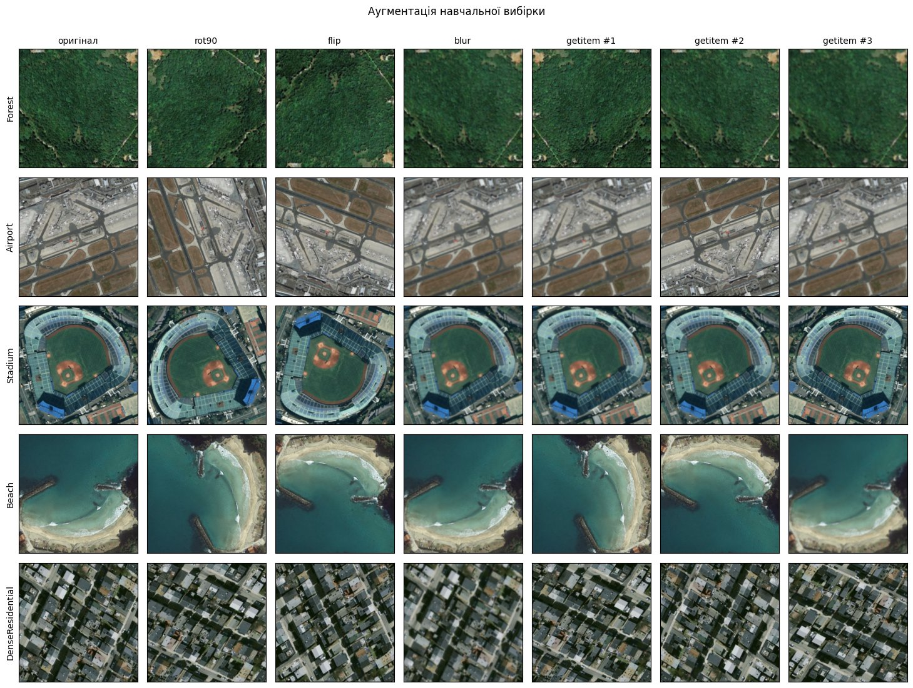 | 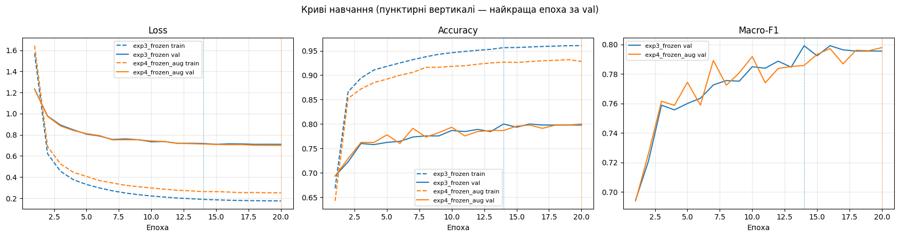 |


**Висновок.**
* **Точність аугментація не покращила.** Val така сама, test нижча на 1.5 п.п. (9 зображень), що близько до шуму.
  Коли навчається лише лінійний шар над фіксованими ознаками, аугментація не може зробити ці ознаки кращими.
  Вона лише ускладнює навчальні приклади, тому train accuracy нижча, а train loss вищий.
* **Перенавчання зменшилось:** розрив train–val скоротився з 15.7 до 14.0 п.п.
* **Стійкість зросла** саме до тих спотворень, які імітує аугментація: поворот 90° дає 0.807 проти 0.778, розмиття
  0.693 проти 0.600.
* Тепер найкраща епоха остання (20/20): з аугментацією модель збігається повільніше.

---

## exp5: + fine-tuning layer4 (завдання 5)

> **Що змінилось порівняно з exp4:** стартуємо з ваг exp4 і **розморожуємо останній згортковий блок `layer4`**.
> Тепер навчаються 8.4 млн параметрів замість 15 тис. Аугментація та сама.

**Вибір стартової моделі** — лише за validation. exp3 і exp4 мають однакову val accuracy (0.800), тому вирішує менший
val loss на найкращій епосі: 0.700 у exp4 проти 0.718 у exp3. Отже, стартуємо з **exp4**.

* **Навчання:** Adam, **LR 1e-4** (у 10 разів менший, щоб не зруйнувати добрі ваги ImageNet), cosine-розклад LR, 15 епох.
* BatchNorm у `layer4` тепер навчається, у `conv1`–`layer3` лишається замороженим.
* Ноутбук: [`step5/Lab2_AID_step5_finetune.ipynb`](step5/Lab2_AID_step5_finetune.ipynb).

| | exp4 (до) | **exp5 (після)** | Δ |
|---|---:|---:|---:|
| train acc | 0.940 | 0.9998 | +6.0 п.п. |
| val acc | 0.800 | **0.902** | +10.2 п.п. |
| **test acc** | 0.790 | **0.903** | **+11.3 п.п.** |
| test macro-F1 | 0.789 | **0.901** | +11.2 п.п. |
| train-val gap | 0.140 | **0.098** | −4.2 п.п. |
| стійкість | 0.680 | **0.787** | +10.7 п.п. |

Найкраща епоха — 10 з 15, навчання тривало 105 с. На тесті **виправлено 76 помилок і з'явилось лише 8 нових**.

| Криві: exp4 (епохи 1–20) → fine-tuning (21–35) | Зміна precision / recall по класах |
|---|---|
| 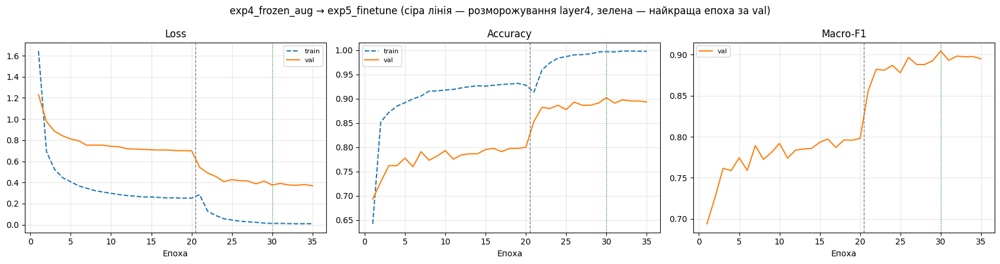 | 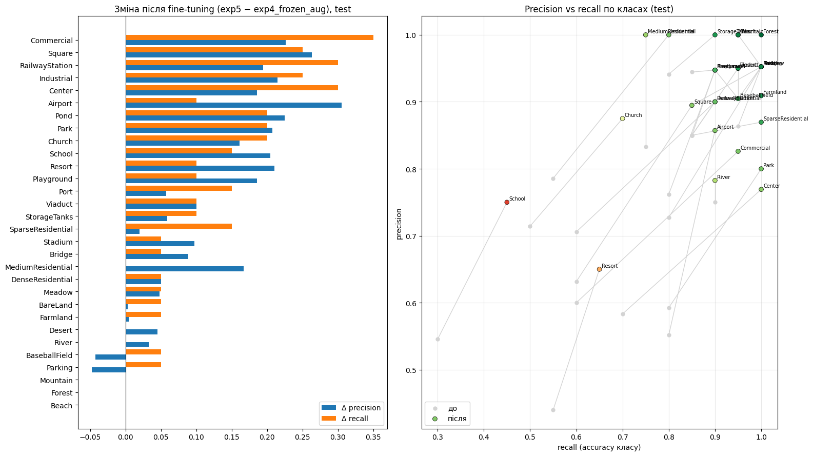 |

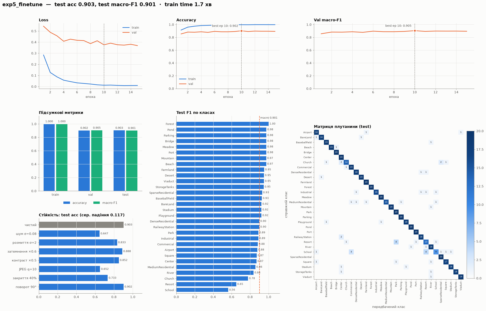

**Висновок.** Це найбільший приріст у всій роботі: +11 п.п. Останній блок перебудовує високорівневі ознаки під
аерознімки, тобто під текстури забудови, форми об'єктів і взаємне розташування. Модель майже ідеально запам'ятовує train
(0.9998), проте розрив train–val **зменшився** до 9.8 п.п., бо val зросла сильніше. Отже, більше параметрів тут не
призвело до перенавчання. Найбільше виграли класи, які раніше плутались: `Airport` (F1 0.65 → 0.88), `Center`
(0.64 → 0.87), `Commercial` (0.60 → 0.88), `Park` (0.68 → 0.89). Найслабшими лишились `School` (0.56) і `Resort` (0.65).

exp5 має найвищу val accuracy серед exp3–exp5, тому **вона стає вчителем** для дистиляції.

---

## exp6: компактний учень SmallCNN (завдання 6)

> **Що змінилось:** нова гілка експериментів. Замість ResNet18 тепер компактна CNN, що навчається **з нуля**, без ваг
> ImageNet. Тому в exp7 ефект дистиляції чистий: інших знань ззовні учень не отримує.

```
вхід 3×224×224
Conv3×3 (stride 2)-BN-ReLU, Conv3×3-BN-ReLU, 32 канали → MaxPool → 56×56
[Conv3×3-BN-ReLU] ×2, 64 канали                         → MaxPool → 28×28
[Conv3×3-BN-ReLU] ×2, 128 каналів                       → MaxPool → 14×14
[Conv3×3-BN-ReLU] ×2, 256 каналів                                 → 14×14
GlobalAvgPool → Dropout(0.3) → Linear(256 → 30)
```

* **1 180 926 параметрів, 4.5 МБ.** Це в 9.5 раза менше за ResNet18 (11.2 млн, 42.7 МБ).
* **Навчання:** AdamW (weight decay 5e-4), OneCycle з max LR 3e-3, 40 епох, та сама аугментація, звичайна cross-entropy.
* Початкові ваги збережено в `student_init.pt`, щоб exp7 стартувала з тих самих ваг.
* Ноутбук: [`steps6_10/Lab2_AID_steps6_10.ipynb`](steps6_10/Lab2_AID_steps6_10.ipynb).

| | exp5 (учитель) | **exp6 (учень)** | різниця |
|---|---:|---:|---:|
| параметрів | 11.19 M | **1.18 M** | ÷9.5 |
| val acc | 0.902 | 0.867 | −3.6 п.п. |
| **test acc** | 0.903 | **0.882** | **−2.2 п.п.** |
| test macro-F1 | 0.901 | 0.881 | −2.0 п.п. |
| train-val gap | 0.098 | 0.130 | +3.2 п.п. |
| стійкість | 0.787 | 0.723 | −6.4 п.п. |

Найкраща епоха — **39 з 40**, навчання тривало 264 с.

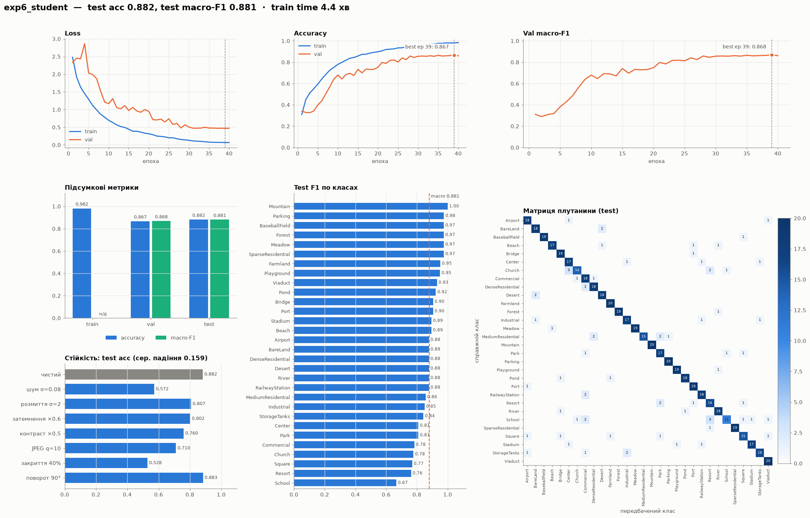

**Висновок.** Учень із 1.2 млн параметрів, навчений з нуля на ~9 тис. зображень, поступається вчителю лише на 2.2 п.п.
Але найкраща епоха — передостання, і val accuracy ще росла. Отже, **40 епох замало**, і це перевіряємо окремо в
[запуску на 200 епох](#учні-на-200-епох-додатковий-експеримент). Учень найменш стійкий до спотворень
(середнє падіння 0.159), особливо до закриття частини кадру: 0.528 проти 0.733 у вчителя. Проте до сильного
JPEG-стиснення він стійкіший за всі ResNet18: 0.710 проти 0.48–0.65.

---

## exp7: + дистиляція знань (завдання 7)

> **Що змінилось порівняно з exp6:** **лише функція втрат.** Учень навчається не тільки за мітками, а й за «м'якими»
> ймовірностями вчителя exp5. Початкові ваги, 40 епох, оптимізатор, scheduler, аугментація і порядок батчів ті самі.

Функція втрат (Hinton et al., 2015):

$$L = \alpha \cdot T^2 \cdot \mathrm{KL}\big(\mathrm{softmax}(z_t/T)\,\|\,\mathrm{softmax}(z_s/T)\big) + (1-\alpha)\cdot \mathrm{CE}(z_s, y)$$

* **Температура T = 4.** Вона «розм'якшує» розподіл учителя, щоб учень бачив, які класи вчитель вважає схожими
  (наприклад, `School` ↔ `Commercial`), а не лише правильну відповідь.
* **Вага дистиляційної складової α = 0.7.** Звичайна cross-entropy з мітками має вагу 0.3.
* Множник T² компенсує зменшення градієнтів через ділення логітів на T.
* Учитель працює в `eval()`, без градієнтів, і бачить той самий аугментований батч, що й учень.

| | exp6 (без KD) | **exp7 (з KD)** | Δ |
|---|---:|---:|---:|
| val acc | 0.867 | **0.887** | +2.0 п.п. |
| **test acc** | 0.882 | **0.885** | +0.3 п.п. |
| test macro-F1 | 0.881 | 0.881 | +0.1 п.п. |
| train-val gap | 0.130 | **0.100** | −3.0 п.п. |
| стійкість | 0.723 | **0.742** | +1.9 п.п. |
| час навчання | 264 с | 422 с | +60% (прохід через вчителя) |

На тесті виправлено 17 помилок і з'явилось 15 нових.

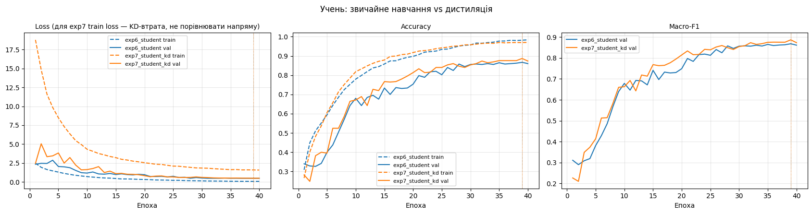

На графіку train loss exp7 — це KD-втрата. Вона має інший масштаб, тому напряму з exp6 її порівнювати не можна.


**Висновок.**
* **На validation** дистиляція дала +2 п.п., **на тесті** лише +0.3 п.п. (2 зображення), що в межах шуму.
* **Помітно зменшилось перенавчання:** розрив train–val скоротився з 13.0 до 10.0 п.п. М'які цілі вчителя менш «упевнені»,
  ніж one-hot мітки, і працюють як регуляризація.
* Стійкість до спотворень зросла на 1.9 п.п.: учень перейняв частину інваріантності вчителя.
* Розрив до вчителя (`exp5` → `exp7`): −1.8 п.п. test accuracy при 9.5 раза меншій кількості параметрів.
* Найкраща епоха знову **39 з 40**: модель ще не досягла плато.

---

## Учні на 200 епох (додатковий експеримент)

> **Що змінилось порівняно з exp6 / exp7:** лише бюджет навчання, **200 епох замість 40**. OneCycle розтягується на
> весь бюджет. Архітектура, початкові ваги, оптимізатор, аугментація, учитель exp5 і T = 4, α = 0.7 ті самі.
> Мета — з'ясувати межі компактного учня і те, чи дає дистиляція виграш, коли учня навчають довго.

Ноутбук: [`students200/Lab2_AID_students_200ep.ipynb`](students200/Lab2_AID_students_200ep.ipynb).

| | exp6 (40 еп.) | **student_200ep** | exp7 (40 еп., KD) | **student_kd_200ep** |
|---|---:|---:|---:|---:|
| найкраща епоха | 39 | 125 | 39 | 122 |
| плато (val ≥ max − 1 п.п.) | — | з 125-ї | — | з **109-ї** |
| val acc | 0.867 | 0.902 | 0.887 | **0.924** |
| **test acc** | 0.882 | **0.903** | 0.885 | 0.902 |
| test macro-F1 | 0.881 | **0.903** | 0.881 | 0.900 |
| train-val gap | 0.130 | 0.098 | 0.100 | **0.075** |
| val loss (CE) на найкращій епосі | 0.47 | 0.60 | 0.48 | **0.34** |
| час навчання | 4.4 хв | 23 хв | 7.0 хв | 36 хв |

Порівняння за кількістю виправлених і нових помилок на тесті:

| Перехід | Виправлено | Нових | Помилок разом |
|---|---:|---:|---|
| exp6 → student_200ep (довше навчання) | 25 | 12 | 71 → 58 |
| exp7 → student_kd_200ep (довше навчання) | 23 | 13 | 69 → 59 |
| student_200ep → student_kd_200ep (+KD) | 16 | 17 | 58 → 59 |

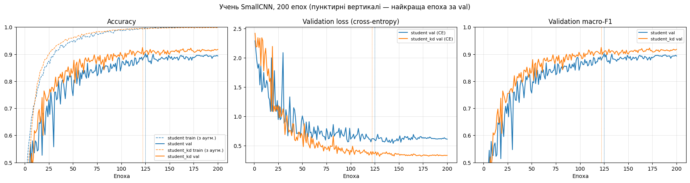

| student_200ep | student_kd_200ep |
|---|---|
| 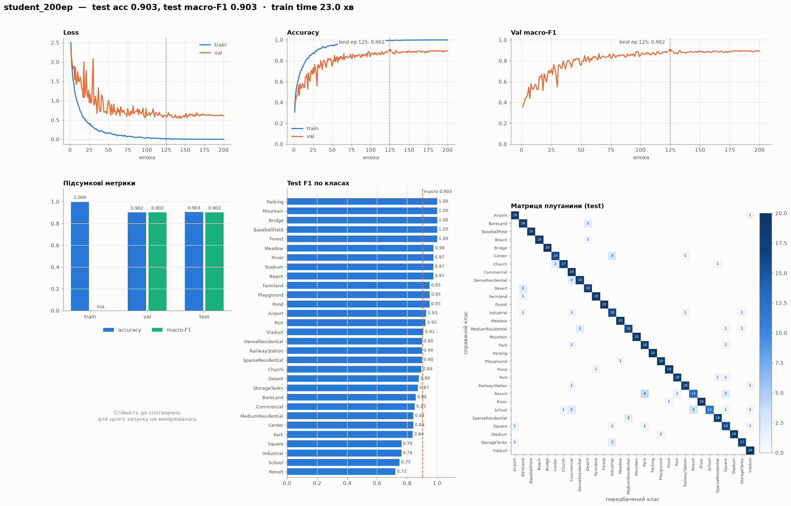 | 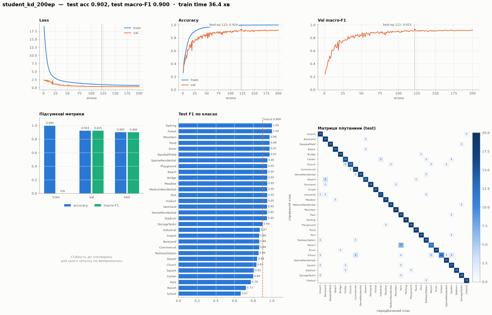 |

**Висновок.**
* **Довше навчання — головний резерв учня:** +2.2 п.п. test без дистиляції і +1.7 п.п. з дистиляцією.
  Учень на 200 епох **досягає рівня вчителя** (test 0.903) при 9.5 раза меншій кількості параметрів.
* **Дистиляція і тут покращує val** (+2.2 п.п., найвища val у всій роботі — 0.924), швидше виходить на плато
  (109-та епоха проти 125-ї) і дає найменший розрив train–val (7.5 п.п.). Її val loss майже вдвічі нижчий,
  тобто ймовірності краще відкалібровані.
* **На тесті виграшу від дистиляції немає:** 0.902 проти 0.903, 16 виправлених і 17 нових помилок. Приріст на val
  (10 зображень з 450) не переноситься на test. Вибір епохи за невеликою val частково підлаштовується під неї.
* Найслабші класи після 200 епох ті самі, що й у вчителя: `Resort` (F1 0.72), `School` (0.67–0.75), `Square`, `Industrial`.

> **Примітка.** У `student_200ep` і `exp5_finetune` збігаються train / val / test accuracy (0.9998 / 0.902 / 0.903).
> Це збіг кількості правильних відповідей, а не копіювання результатів: кожна модель має 58 помилок на тесті, але різних —
> 27 зображень правильні лише в одній моделі і 27 лише в іншій. Macro-F1 у них теж різні (0.903 і 0.901).

---

## Аналіз помилок і Grad-CAM (завдання 8)

Порівнюємо вчителя `exp5_finetune` і двох учнів `exp6` / `exp7`. Матриці помилок усіх моделей наведено на дашбордах
у `plots/`. Найчастіші пари «справжній клас → прогноз» на тесті:

| exp5 (учитель) | exp6 (учень) | exp7 (учень + KD) |
|---|---|---|
| Resort → Park (4) | Church → Center (3) | Desert → BareLand (4) |
| School → Resort (4) | School → Resort (3) | School → Resort (4) |
| School → Commercial (3) | BareLand → Desert (2) | Resort → Park (3) |
| Church → Center (2) | Church → Resort (2) | School → Commercial (3) |
| Church → SparseResidential (2) | DenseResidential → Commercial (2) | School → Park (3) |

Помилки всіх моделей зосереджені в одних і тих самих групах. Це міські об'єкти з однаковими будівлями, різниця між
якими в контексті й призначенні (`School`, `Resort`, `Park`, `Commercial`, `Center`, `Church`), а також `Desert` ↔ `BareLand`.

**Grad-CAM** показує, які ділянки найбільше вплинули на рішення. Беремо активації останнього згорткового шару, зважуємо
їх градієнтом логіта передбаченого класу і накладаємо карту на зображення. Рядки згруповано так:
«усі моделі праві», «учитель помилився», «учитель правий, учні — ні».

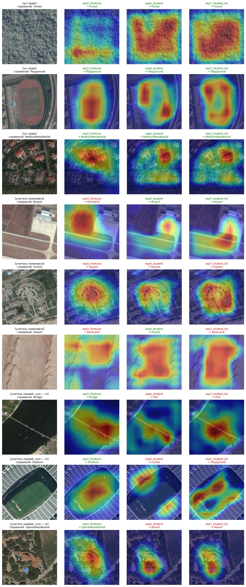

Спостереження:

* **Правильні прогнози.** Учитель фокусується на характерному об'єкті: на полі в `Playground`, на будинках у
  `MediumResidential`. Учні частіше дивляться на краї об'єкта, наприклад на бігову доріжку, а не на поле.
* **Учитель помилився `Airport → Farmland`,** бо дивився на поле біля аеропорту. Учні зосередились на літаку й терміналі
  і відповіли правильно. Така сцена містить ознаки обох класів.
* **`School → Square`.** Усі три моделі дивляться на круглу площу перед будівлею. Ця ознака справді типова для `Square`,
  тому помилка зрозуміла.
* **Учні помиляються там, де дивляться на фон:** `Bridge → Port` (увага на воді, а не на мосту), `Stadium → Center`
  (увага на трибунах і даху), `SparseResidential → Resort` (вілла з басейном).
* На однорідних текстурах (`Forest`) учні «розливають» увагу на весь кадр, а учитель спирається на окрему ділянку.
  Тобто учням потрібна вся текстура, а вчителю досить фрагмента.

---

## Покращення та погіршення по класах (завдання 9)

Порівнюємо дві пари з однаковими початковими вагами: **exp4 vs exp3** (вплив аугментації) і **exp7 vs exp6**
(вплив дистиляції).

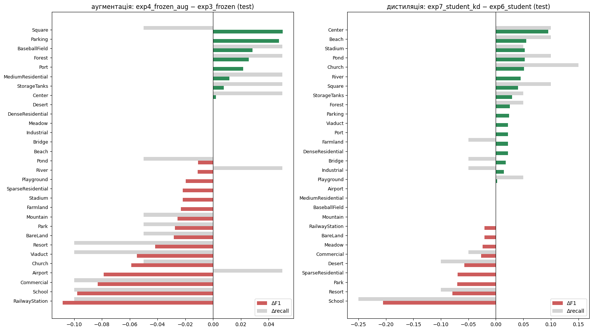

| | Найбільше покращення (ΔF1) | Найбільше погіршення (ΔF1) | Виправлено / нових помилок |
|---|---|---|---|
| **аугментація** (exp3 → exp4) | Square +0.05, Parking +0.05, BaseballField +0.03 | RailwayStation −0.11, School −0.10, Commercial −0.08 | 11 / 20 |
| **дистиляція** (exp6 → exp7) | Center +0.10, Beach +0.06, Stadium +0.05 | School −0.21, Resort −0.08, Park −0.07 | 17 / 15 |

**Висновок.** Зміна способу навчання не просто виправляє помилки, а «перетасовує» їх: в обох парах кількість нових
помилок порівнянна з кількістю виправлених. Від аугментації найбільше постраждали міські класи (`RailwayStation`,
`School`, `Commercial`). Для лінійного класифікатора над фіксованими ознаками повернуті й розмиті версії цих сцен
складніші. Дистиляція допомогла класам, які вчитель розпізнає впевнено (`Center`, `Beach`, `Stadium`). На `School`
стало гірше: учитель сам найгірше впорався саме з цим класом (F1 0.56) і передав учню свою плутанину
`School ↔ Resort / Commercial`.

---

## Стійкість, розмір і швидкість (завдання 10)

Усі моделі exp3–exp7 оцінено на тестових зображеннях зі спотвореннями, яких не було в навчанні або які були лише слабкими:

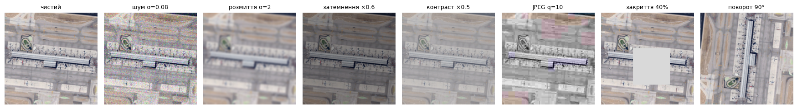

| test accuracy | чистий | шум σ=0.08 | розмиття σ=2 | затемн. ×0.6 | контраст ×0.5 | JPEG q=10 | закриття 40% | поворот 90° | **середня** | **падіння** |
|---|---:|---:|---:|---:|---:|---:|---:|---:|---:|---:|
| exp3_frozen | 0.805 | 0.535 | 0.600 | 0.777 | 0.745 | 0.483 | 0.707 | 0.778 | 0.661 | 0.144 |
| exp4_frozen_aug | 0.790 | 0.532 | 0.693 | 0.778 | 0.735 | 0.523 | 0.690 | 0.807 | 0.680 | **0.110** |
| exp5_finetune | **0.903** | **0.647** | **0.833** | **0.888** | **0.852** | 0.652 | **0.733** | **0.902** | **0.787** | 0.117 |
| exp6_student | 0.882 | 0.572 | 0.807 | 0.802 | 0.760 | **0.710** | 0.528 | 0.883 | 0.723 | 0.159 |
| exp7_student_kd | 0.885 | 0.585 | 0.787 | 0.828 | 0.812 | 0.652 | 0.653 | 0.877 | 0.742 | 0.143 |

Для запусків на 200 епох стійкість не вимірювалась.

| | Параметрів | Розмір | GPU (T4), зобр./с | CPU, мс / зображення |
|---|---:|---:|---:|---:|
| ResNet18 (exp3–exp5) | 11 191 902 | 42.7 МБ | ≈ 2 300 | ≈ 30 |
| SmallCNN (exp6, exp7, 200 еп.) | 1 180 926 | 4.5 МБ | ≈ 5 100 | ≈ 11 |

### Зведена таблиця

| Модель | Опис | Параметрів (навчались) | val acc | test acc | test F1 | train-val gap | стійкість |
|---|---|---:|---:|---:|---:|---:|---:|
| exp3_frozen | ResNet18, заморожена основа | 11.19 M (15 390) | 0.800 | 0.805 | 0.806 | 0.157 | 0.661 |
| exp4_frozen_aug | + аугментація | 11.19 M (15 390) | 0.800 | 0.790 | 0.789 | 0.140 | 0.680 |
| exp5_finetune | + fine-tuning `layer4` | 11.19 M (8 409 118) | 0.902 | **0.903** | 0.901 | 0.098 | **0.787** |
| exp6_student | SmallCNN з нуля, 40 еп. | 1.18 M | 0.867 | 0.882 | 0.881 | 0.130 | 0.723 |
| exp7_student_kd | + дистиляція (T=4, α=0.7) | 1.18 M | 0.887 | 0.885 | 0.881 | 0.100 | 0.742 |
| student_200ep | SmallCNN, 200 еп. | 1.18 M | 0.902 | **0.903** | **0.903** | 0.098 | — |
| student_kd_200ep | + дистиляція, 200 еп. | 1.18 M | **0.924** | 0.902 | 0.900 | **0.075** | — |

> У виконаному на Kaggle ноутбуці `steps6_10` (клітинка 40) у колонці «параметрів, що навчались» для exp3–exp5 стоїть 0.
> Це помилка в коді тієї версії: значення бралось з уже повністю заморожених завантажених моделей. Її виправлено
> в `steps6_10/Lab2_AID_steps6_10.ipynb` і в `steps6_10/out/results_all.csv`. Правильні значення наведено в таблиці вище.

---

## Висновки

1. **Найточніша модель — `exp5_finetune`** (ResNet18 з донавченим `layer4`): test accuracy 0.903, macro-F1 0.901.
   Fine-tuning останнього блоку дав найбільший приріст у роботі (+11 п.п.). Адаптація високорівневих ознак до
   аерознімків важливіша за будь-які інші зміни.
2. **Найкомпактніша — SmallCNN-учень:** 1.18 млн параметрів (у 9.5 раза менше), 4.5 МБ, у 2.8 раза швидша на CPU (11 проти 31 мс).
   За 40 епох вона поступається вчителю на ~2 п.п., а за 200 епох **досягає його точності** на тесті.
3. **Найстійкіша — `exp5_finetune`:** середня accuracy 0.787 на спотвореннях. Найменше відносне падіння має `exp4`
   (0.110), але з нижчого стартового рівня. Учні найчутливіші до закриття частини кадру, зате найкраще витримують
   JPEG-артефакти.
4. **Аугментація** з замороженою основою не підвищила точність, бо лінійний шар не може покращити фіксовані ознаки.
   Проте вона зменшила перенавчання і додала стійкості до поворотів і розмиття. У поєднанні з fine-tuning і для учнів
   з нуля аугментація застосовувалась завжди.
5. **Дистиляція** стабільно покращує validation (+2 п.п.), зменшує розрив train–val (з 13.0 до 10.0 п.п. за 40 епох,
   до 7.5 п.п. за 200) і дає краще відкалібровані ймовірності. На тесті її ефект у межах шуму (+0.3 п.п. і −0.2 п.п.).
   Вона прискорює вихід на плато, але не підіймає стелю учня.
6. **Типові помилки всіх моделей** — між семантично близькими міськими класами (`School`, `Resort`, `Park`,
   `Commercial`, `Center`, `Church`). Grad-CAM показує, що в цих сценах моделі спираються на спільні для кількох класів
   об'єкти: площі, басейни, поля, звичайні будівлі.

---

## Структура репозиторію

```
.
├── README.md                              # цей звіт
├── make_split.py                          # поділ AID на train / val / test
├── plot_runs.py                           # дашборди метрик для кожного запуску -> plots/
├── requirements.txt
├── Lab2_AID_stage2_data_analysis.ipynb    # завдання 1–2: аналіз даних (локально, CPU)
├── Lab2_CNN_AID_variant3.ipynb            # ранній чорновий ноутбук для Colab (замінений наступними)
├── steps3_4/                              # exp3, exp4                     (Kaggle-кернел lab2-aid-steps3-4)
├── step5/                                 # exp5                           (lab2-aid-step5-finetune)
├── steps6_10/                             # exp6, exp7, аналіз, стійкість  (lab2-aid-steps6-10)
│   ├── Lab2_AID_steps6_10.ipynb           #   код з виправленням (див. примітку вище)
│   └── Lab2_AID_steps6_10_kaggle_executed.ipynb   # виконана на Kaggle версія з усіма виводами
├── students200/                           # учні на 200 епох               (lab2-aid-students-200ep)
│   └── …/out/                             # у кожній папці: results*.csv, histories*.json, test_preds*.npz, лог
├── artifacts/split.csv                    # зафіксований поділ (path, class, label, split)
├── plots/                                 # дашборд кожного запуску + summary.png
└── figures/                               # ілюстрації з виконаних ноутбуків, що використані в README
```

Ваги моделей (`*.pt`, до 43 МБ кожна) і датасет у репозиторій не додано. Ваги лежать у виходах відповідних
Kaggle-кернелів, а `plot_runs.py` і цей звіт потребують лише CSV / JSON / NPZ з папок `*/out/`.

## Відтворення

### 1. Середовище

```bash
python -m venv .venv
.venv/bin/pip install -r requirements.txt
```

### 2. Датасет

Потрібен [Kaggle API token](https://www.kaggle.com/docs/api) (`~/.kaggle/kaggle.json`):

```bash
pip install kaggle
kaggle datasets download jiayuanchengala/aid-scene-classification-datasets -p data --unzip
```

Після розпакування класи мають лежати в `data/AID/<Клас>/<клас>_<номер>.jpg`
(30 папок, 10 000 файлів). Якщо архів розпакувався з іншою вкладеністю, перемістіть папку `AID` у `data/`.

### 3. Поділ на train / val / test

Точно той самий поділ, що використано в роботі, береться з `artifacts/split.csv`. Ембедінги перераховувати не треба:

```bash
.venv/bin/python make_split.py --from-csv
```

Результат: `data/AID_split/{train,val,test}/<Клас>/…`. Це 8950 / 450 / 600 зображень, розкладених жорсткими посиланнями,
тому місце на диску не дублюється.

Щоб побудувати поділ заново тим самим алгоритмом (ознаки ResNet18 → відбір несхожих зображень у val / test), запустіть
без прапорця. На CPU обчислення ознак займає кілька хвилин, результат кешується в `artifacts/embeddings.npz`:

```bash
.venv/bin/python make_split.py
```

Ноутбукам `data/AID_split` не потрібен: поділ уже вбудовано в них як номери файлів (`VAL_TEST`). Вони читають оригінальну
`data/AID/` локально або `/kaggle/input/...` на Kaggle і перевіряють, що поділ збігається.

### 4. Навчання (Kaggle, GPU)

Кожна папка з ноутбуком має `kernel-metadata.json`. Кернели запускаються по черзі, бо кожен наступний читає ваги
попереднього як input:

```bash
kaggle kernels push -p steps3_4      # exp3, exp4
kaggle kernels push -p step5         # exp5        (потребує steps3_4)
kaggle kernels push -p steps6_10     # exp6, exp7  (потребує steps3_4, step5)
kaggle kernels push -p students200   # 200 епох    (потребує step5)

kaggle kernels output <user>/lab2-aid-steps3-4 -p steps3_4/out   # аналогічно для інших
```

Перед запуском замініть `nikitaryzhenko` у полях `id` і `kernel_sources` на свій логін Kaggle.

### 5. Графіки

```bash
.venv/bin/python plot_runs.py        # -> plots/<запуск>.png, plots/summary.png
```
